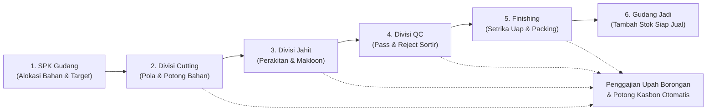

# 🧵 Sistem Manajemen Ruang Konveksi (ERP & SOP Produksi)

Aplikasi manajemen operasional konveksi dan garmen terpadu berbasis **React + Vite** (Frontend) dan **Node.js Express + MySQL** (Backend). Dirancang untuk mengelola seluruh rantai kerja mulai dari permintaan produksi gudang (SPK), pemotongan bahan (cutting), penjahitan (sewing), kontrol mutu (QC), penyelesaian akhir (finishing), mutasi stok gudang jadi, hingga penggajian borongan dan pemotongan kasbon.

---

## 🚀 Ringkasan Arsitektur & Teknologi

| Komponen          | Spesifikasi                                             | Keterangan                                                      |
| :---------------- | :------------------------------------------------------ | :-------------------------------------------------------------- |
| **Frontend**      | React 19, Vite, Tailwind CSS, Lucide React, SweetAlert2 | Single Page App (Desktop + Mobile Responsive)                   |
| **Backend**       | Node.js (ES Modules), Express.js (Port `3001`)          | RESTful API modular di `server/`                                |
| **Database**      | MySQL Server 8 (Database: `konveksi`, Port `3306`)      | Connection Pool via `mysql2/promise`                            |
| **State & Sync**  | Direct API Sync + URL Hash Routing                      | Auto-sync Desktop & Mobile (`#antrean`, `#divisi-cutting`, dll) |
| **Live Tracking** | Customer Tracking via URL Hash                          | `#tracking/{noAntrian}` (Tanpa login untuk pelanggan)           |

---

## 🔄 Alur Proses Operasional (6 Tahapan SOP Konveksi)



### Detail Tahapan:

1. **Tahap 1: SPK (Surat Perintah Kerja) Produksi**
   - **Aktor**: Admin Gudang / Super Admin (`src/views/desktop/Antrean.jsx` atau `PermintaanProduksiGudang.jsx`).
   - **Tindakan**: Mendaftarkan nomor batch SPK (`ANT-YYYYMMDD-XXX`), memilih model SKU, target kuantiti, prioritas (`Urgent`/`Normal`), deadline, dan **alokasi resep bahan baku per pcs** (BOM - Bill of Materials).
   - **Status Awal**: `Menunggu Cutting`.

2. **Tahap 2: Divisi Cutting (Pola & Potong Kain)**
   - **Aktor**: Admin Cutting (`src/views/desktop/divisi/DivisiCutting.jsx`).
   - **Tindakan**: Approval SPK, input tanggal mulai potong, ongkos potong otomatis dari master produk, dan pemotongan kain. Kain yang sedang/selesai dipotong langsung siap diambil penjahit tanpa perlu tombol serah terima manual.
   - **Status**: Berubah menjadi `Proses Cutting`. Tercatat upah borongan cutting di antrean.

3. **Tahap 3: Divisi Jahit (Sewing & Makloon)**
   - **Aktor**: Admin Jahit / Tukang Jahit (`src/views/desktop/divisi/DivisiJahit.jsx`).
   - **Tindakan**: Melihat antrean kain di tab *Siap Diambil (Cutting)* lalu klik **Ambil** (1-klik). Sistem otomatis menyelesaikan cutting, mengalokasikan ke penjahit aktif, dan menerapkan tarif jahit.
   - **Status**: Otomatis berubah menjadi `Proses Jahit`.

4. **Tahap 4: Divisi QC (Quality Control & Sortir)**
   - **Aktor**: Admin QC (`src/views/desktop/divisi/DivisiQC.jsx`).
   - **Tindakan**: Memeriksa kerapian jahitan, ukuran, noda, dan cacat kain. Mencatat jumlah lolos (`qty_pass_qc`) dan jumlah afkir/perbaikan (`qty_reject_qc`).
   - **Status**: Berubah menjadi `Proses QC`.

5. **Tahap 5: Divisi Finishing & Kemas**
   - **Aktor**: Admin Finishing (`src/views/desktop/divisi/DivisiFinishing.jsx`).
   - **Tindakan**: Pembersihan sisa benang, setrika uap, pemasangan hangtag/label merek, pelipatan, dan pengemasan plastik OPP polybag.
   - **Status**: Berubah menjadi `Proses Finishing`.

6. **Tahap 6: Serah Terima ke Gudang Jadi**
   - **Aktor**: Admin Gudang / Finishing (`src/views/desktop/MutasiGudangJadi.jsx`).
   - **Tindakan**: Verifikasi penerimaan fisik produk siap jual ke rak penyimpanan gudang.
   - **Hasil**: Otomatis menambah stok produk pada tabel `products` dan mencatat kartu stok masuk pada `mutasi_gudang_jadi`. Status akhir: `Selesai Gudang`.

7. **Sistem Penggajian Upah Borongan & Pemotongan Kasbon**
   - **Aktor**: Super Admin / Keuangan (`src/views/desktop/pembayaran/`).
   - **Tindakan**: Rekapitulasi upah per pcs dari seluruh tahapan (Cutting, Jahit, QC, Finishing).
   - **Fitur Otomatis**: Jika karyawan/penjahit memiliki sisa pinjaman kasbon aktif di tabel `kasbon`, sistem otomatis menampilkan opsi potongan kasbon saat cetak slip dan pelunasan upah.

---

## 👥 Sistem Hak Akses Pengguna (RBAC 6 Role)

Konfigurasi role didefinisikan pada [src/constants/userRoles.js](file:///g:/Konveksi/src/constants/userRoles.js):

| Role Key     | Nama Role       | Hak Akses Menu Utama                                                       | Default Menu          | Akun Bawaan (User / Pass) |
| :----------- | :-------------- | :------------------------------------------------------------------------- | :-------------------- | :------------------------ |
| `superadmin` | Super Admin     | Seluruh Menu Sistem & Pengaturan Keuangan                                  | `dashboard`           | `admin` / `123456`        |
| `gudang`     | Admin Gudang    | SPK Produksi, Mutasi Gudang Jadi, Master Bahan, Mutasi Bahan, Laporan Stok | `permintaan-produksi` | `gudang` / `123456`       |
| `cutting`    | Admin Cutting   | Dashboard, Divisi Cutting, Master Bahan, Mutasi Bahan                      | `divisi-cutting`      | `cutting` / `123456`      |
| `jahit`      | Admin Jahit     | Dashboard, Divisi Jahit, Master Penjahit                                   | `divisi-jahit`        | `jahit` / `123456`        |
| `qc`         | Admin QC        | Dashboard, Divisi QC                                                       | `divisi-qc`           | `qc` / `123456`           |
| `finishing`  | Admin Finishing | Dashboard, Divisi Finishing, Mutasi Gudang Jadi                            | `divisi-finishing`    | `finishing` / `123456`    |

---

## 📂 Struktur Direktori & File Kunci

```
konveksi/
├── server/                           # BACKEND NODE.JS + EXPRESS
│   ├── index.js                      # Entry point Express, routing, static serve SPA
│   ├── db/
│   │   ├── database.js               # MySQL Pool connection & migrasi kolom runtime
│   │   └── schema.mysql.sql          # DDL Skema tabel resmi MySQL & data seed
│   └── routes/                       # RESTful API Endpoints
│       ├── antrean.js                # CRUD SPK & update tahapan SOP (cutting/jahit/qc/finish)
│       ├── products.js               # Master produk, varian, ukuran, HPP & resep BOM
│       ├── categories.js             # Master kategori produk & tarif dasar potong
│       ├── bahan.js                  # Master bahan baku (kain, benang, aksesoris)
│       ├── mutasiBahan.js            # Kartu stok & pencatatan keluar/masuk bahan
│       ├── mutasiGudangJadi.js       # Penerimaan barang jadi dari produksi ke gudang
│       ├── employees.js              # Data tenaga kerja (karyawan, penjahit, tim finishing)
│       ├── pembayaranUpah.js         # Rekapitulasi upah borongan & pencatatan slip
│       ├── kasbon.js                 # Pinjaman kasbon & histori potong gaji
│       └── users.js                  # Otentikasi & manajemen pengguna RBAC
│
├── src/                              # FRONTEND REACT (VITE)
│   ├── App.jsx                       # Controller utama, auth state, auto-detect mobile/desktop
│   ├── main.jsx                      # Entrypoint React DOM
│   ├── services/
│   │   └── api.js                    # HTTP client wrapper (Axios / Fetch ke /api)
│   ├── constants/
│   │   └── userRoles.js              # Definisi RBAC 6 Role, tema warna & izin menu
│   ├── components/layout/
│   │   ├── TopHeader.jsx             # Top bar desktop (switch role, status DB, profil)
│   │   └── Sidebar.jsx               # Navigasi drawer desktop modular
│   │
│   ├── views/desktop/                # TAMPILAN DESKTOP (LAYAR LEBAR)
│   │   ├── DashboardWelcome.jsx      # Dashboard analitik KPI & pintasan cepat
│   │   ├── Antrean.jsx               # Manajemen SPK Pabrik (Tampilan lebar 100%, resep bahan)
│   │   ├── PermintaanProduksiGudang.jsx # Permintaan restock khusus tim gudang
│   │   ├── divisi/
│   │   │   ├── DivisiCutting.jsx     # Modul Tahap 2: Approval potong, tim cutting & ongkos
│   │   │   ├── DivisiJahit.jsx       # Modul Tahap 3: Alokasi penjahit & makloon
│   │   │   ├── DivisiQC.jsx          # Modul Tahap 4: Pemeriksaan mutu, pass & reject
│   │   │   └── DivisiFinishing.jsx   # Modul Tahap 5: Packing, setrika & serah gudang
│   │   ├── Produk.jsx                # Master produk & kalkulator HPP resep bahan
│   │   ├── Bahan.jsx                 # Master stok kain & aksesoris
│   │   ├── MutasiBahan.jsx           # Input mutasi stok bahan baku
│   │   ├── MutasiGudangJadi.jsx      # Kartu mutasi produk jadi siap jual
│   │   ├── Karyawan.jsx              # Master tenaga kerja pabrik
│   │   ├── LaporanStokGudang.jsx     # Laporan valuasi aset stok barang jadi
│   │   ├── pembayaran/               # Penggajian borongan, slip upah & potong kasbon
│   │   ├── Kasbon.jsx                # Manajemen pinjaman karyawan
│   │   └── Users.jsx                 # Manajemen akun & hak akses
│   │
│   ├── views/mobile/                 # TAMPILAN KHUSUS SMARTPHONE (< 768px)
│   │   ├── MobileApp.jsx             # Root container mobile & URL hash synchronizer
│   │   ├── MobileHeader.jsx          # App bar mobile adaptif sesuai tema role
│   │   ├── MobileNavigation.jsx      # Bottom navigation bar
│   │   ├── DashboardMobile.jsx       # Metrik ringkas operasional mobile
│   │   ├── AntreanMobile.jsx         # Antrean kerja & status pipeline mobile
│   │   ├── LanjutTahapModalMobile.jsx# Bottom sheet serah tahapan produksi (cutting -> finish)
│   │   └── MutasiMobile.jsx          # Mutasi fisik mobile
│   │
│   └── views/tracking/
│       └── CustomerTracking.jsx      # Pelacakan status pesanan live untuk pelanggan publik
```

---

## 🗄️ Skema Database MySQL (`konveksi`)

Tabel-tabel utama di database MySQL:

| Nama Tabel           | Fungsi Utama                                         | Kolom Kunci                                                                                                                                                                                                    |
| :------------------- | :--------------------------------------------------- | :------------------------------------------------------------------------------------------------------------------------------------------------------------------------------------------------------------- |
| `users`              | Akun pengguna sistem dan role                        | `id`, `username`, `password`, `role`, `status`                                                                                                                                                                 |
| `categories`         | Kelompok produk & tarif standar potong               | `id`, `kode`, `nama`, `harga_potong`, `status`                                                                                                                                                                 |
| `products`           | Master SKU pakaian, varian, ukuran, HPP              | `id`, `sku_induk`, `sku`, `nama_produk`, `stok`, `hpp`, `kebutuhan_bahan`                                                                                                                                      |
| `bahan`              | Master kain, benang, kancing, aksesoris              | `id`, `kode_bahan`, `nama_bahan`, `satuan`, `stok`, `harga`                                                                                                                                                    |
| `mutasi_bahan`       | Header mutasi keluar/masuk bahan baku                | `id`, `no_bukti`, `tgl`, `jenis_mutasi` (`MASUK`/`KELUAR`)                                                                                                                                                     |
| `mutasi_bahan_item`  | Detail item bahan yang dimutasi                      | `id`, `mutasi_id`, `kode_bahan`, `qty`, `harga`, `total`                                                                                                                                                       |
| `antrean`            | Core SPK produksi & riwayat 6 tahapan                | `id`, `no_antrian`, `sku`, `qty`, `status`, `tgl_serah_cutting`, `tim_cutting`, `tarif_cutting`, `tgl_serah_jahit`, `tim_jahit`, `tarif_jahit`, `qty_pass_qc`, `qty_reject_qc`, `kebutuhan_bahan`, `total_hpp` |
| `mutasi_gudang_jadi` | Riwayat stok barang jadi masuk/keluar                | `id`, `no_mutasi`, `sku`, `qty`, `jenis_mutasi`, `lokasi_rak`, `petugas`                                                                                                                                       |
| `employees`          | Database tenaga kerja (potong, jahit, qc, finishing) | `id`, `nik`, `nama`, `bagian`, `kategori` (`Harian`/`Borongan`/`Makloon`)                                                                                                                                      |
| `pembayaran_upah`    | Transaksi pembayaran upah borongan per batch         | `id`, `no_pembayaran`, `no_antrian`, `tahapan`, `nama_petugas`, `total_upah`, `potongan_kasbon`, `total_bersih`, `status_bayar`                                                                                |
| `kasbon`             | Data pinjaman dana karyawan                          | `id`, `no_kasbon`, `nama_petugas`, `nominal`, `terbayar`, `sisa`, `status`                                                                                                                                     |
| `kasbon_pembayaran`  | Log pemotongan kasbon dari slip upah                 | `id`, `kasbon_id`, `pembayaran_upah_id`, `nominal_potong`, `tgl_potong`                                                                                                                                        |

---

## 🛠️ Perintah Pengoperasian & Deployment

### 1. Lingkungan Pengembangan Lokal (Local Dev):

```bash
# Terminal 1: Backend Server (Port 3001)
npm run server

# Terminal 2: Frontend Vite Dev Server (Port 5173)
npm run dev
```

### 2. Deployment Produksi di VPS Linux:

```bash
# Masuk ke direktori proyek
cd /var/www/html/project/konveksi

# Tarik perubahan, compile asset produksi, & restart service
git pull
npm run build
pm2 restart konveksi
```

> **Tips Automasi Server**:
> Pasang Git Hook `post-merge` di VPS agar setiap menjalankan `git pull`, server otomatis mengeksekusi `npm run build` dan `pm2 restart konveksi`:
>
> ```bash
> cat << 'EOF' > .git/hooks/post-merge
> #!/bin/bash
> npm run build
> pm2 restart konveksi
> EOF
> chmod +x .git/hooks/post-merge
> ```
